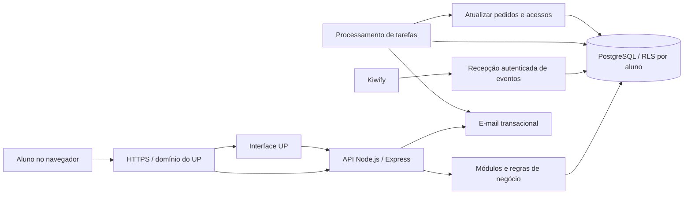
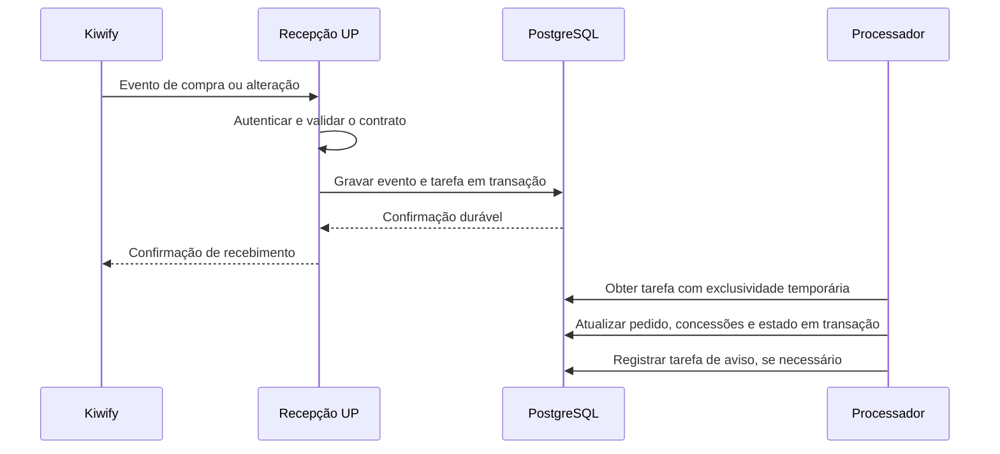

# Arquitetura do Software UP — proposta de evolução

Data: 28/10/2026. Status: arquitetura revisada conforme o PDF, em implementação. A [página de acompanhamento](implementation-progress.md) diferencia módulos já testados, integração em andamento e configurações externas pendentes; a entrada principal agora usa a nova API PostgreSQL; instalação real na VPS ainda pendente.

Fonte de requisitos: **Plataforma UP — Especificação para o Isaias**, de 26/10/2026, Lucas Canedo, 20 páginas. A [matriz de requisitos](pdf-requirements.md) relaciona as decisões às páginas do documento e distingue requisitos, recomendações técnicas e a alteração aprovada de escopo sem IA.

## Objetivo e decisões de partida

Organizar a aplicação existente para receber alunos reais, mantendo o visual aprovado e a primeira versão sem IA. Em 29/10, foi definida uma VPS Hostinger existente, preservando os demais sistemas; o dimensionamento será conferido por inspeção de leitura.

| Assunto | Direção proposta | Situação |
|---|---|---|
| Produto | Diagnóstico, Raio-X e cinco ferramentas dos Kits, com regras e modelos editáveis | Escopo existente; primeira versão sem IA aprovada |
| Organização | Uma aplicação organizada por módulos, no mesmo repositório | Aplicativo único definido no PDF, p. 2; divisão interna proposta |
| Interface | Preservar HTML, CSS, gráficos e formulários; separar o código por funcionalidades gradualmente | Proposta |
| Servidor | Aproveitar Node.js e Express existentes; Node.js 24 LTS como referência inicial | Alternativa permitida pelo PDF, p. 3; não exige refazer as telas em Next.js |
| Dados | PostgreSQL com isolamento por linha (RLS) e tabelas por recurso | Destino proposto para cumprir o isolamento no banco das pp. 3, 15 e 19; MySQL continua sendo a implementação atual |
| Identidade | Usuário identificado por ID estável, com login por código de e-mail | Evolução da autenticação existente |
| Propriedade dos dados | Cada aluno acessa seus próprios registros, ligados a `user_id` | Definido pelo PDF, pp. 3, 15–18; sem organizações ou equipes de clientes no escopo |
| Equipe interna | Perfis `admin` e `suporte`, com restrição de dados individuais | Definido pelo PDF, pp. 17–18 |
| Compras | Kiwify confirma pagamento; o servidor calcula as permissões por produto | Regra existente; integração pendente |
| Infraestrutura | Aplicação, banco, e-mail transacional e backups com ambientes separados | SMTP Hostinger escolhido; hospedagem, banco e dimensionamento em aberto |

Não há motivo identificado para começar com serviços independentes por módulo. O processamento de tarefas pode rodar no mesmo processo inicialmente, com registros duráveis no banco e possibilidade de separação posterior.

## O que existe hoje e o que precisa evoluir

| Evidência no código | Consequência | Evolução proposta |
|---|---|---|
| `server/store.js`: um JSON em `up_accounts.data`, chaveado por e-mail | Conta, compras e listas crescem juntas; alterações concorrentes podem se sobrescrever | IDs estáveis, tabelas e operações por recurso |
| `server/index.js`: códigos, sessões e limites em `Map` | Reiniciar encerra sessões e remove limites; processos não compartilham estado | Persistência com expiração e operações atômicas |
| `GET/PUT /api/state` e `app/api.js`: envio de conjuntos de listas | Uma edição pode substituir registros sem relação com ela | Rotas específicas, paginação e controle de versão |
| `app/app.js`: renderização, estado e ações concentrados | Cada mudança exige conhecer grande parte da interface | Módulos de interface, serviço de API e estado por funcionalidade |
| `app/logic.js`: valores monetários calculados com `Number` | Arredondar só na apresentação não resolve diferenças de centavos | Cálculo decimal no servidor e contrato monetário explícito |
| `server/account.js`: concessão local de produto | Pagamentos ainda não liberam ou revogam acesso automaticamente | Pedidos, concessões de acesso e eventos Kiwify persistidos |
| Administração na prévia visual | Não comprova administração autenticada em produção | Rotas administrativas protegidas e permissões próprias |

Esses pontos descrevem a implementação atual. As seções seguintes descrevem o destino proposto, sem afirmar que ele já está pronto.

## Visão geral



O navegador conversa somente com a API do UP. Banco, credenciais da Kiwify e serviço de e-mail ficam no servidor. Interface e API usam a mesma origem para simplificar cookies e publicação. O gateway HTTPS pode ser fornecido pela hospedagem; em VPS, pode ser um proxy configurado para essa função.

O envio transacional usará **SMTP da Hostinger**, conforme decisão do usuário. Essa escolha não depende de hospedar a aplicação no mesmo fornecedor. O preset usa TLS na porta 465, com alternativa STARTTLS obrigatório na 587. Códigos de acesso e recuperação usam o mesmo fluxo sem senha. As credenciais ficam no ambiente privado; configuração e verificação estão em [hostinger-smtp.md](hostinger-smtp.md).

## Módulos e responsabilidades

| Módulo | Responsabilidade |
|---|---|
| Identidade | Usuário, login, sessão, perfil, encerramento e recuperação de acesso |
| Perfil do negócio | Tipo de negócio, tempo de atividade, faixa de faturamento e tamanho da equipe, pertencentes ao aluno |
| Acesso e comercial | Catálogo `front`, `essencial`, `kit`; pedidos; concessões; revogações |
| Diagnóstico | Questionários, respostas pessoais e empresariais, cálculo, versões e comparações |
| Financeiro | Raio-X mensal, lançamentos, contas, dívidas, indicadores e exportações |
| Ferramentas | Roteiros, ofertas, planos, check-ins e procedimentos |
| Conteúdo | Modelos e regras versionados, com revisão editorial e publicação |
| Operação | Administração, auditoria, tarefas, notificações e integrações |

Cada módulo contém validação de entrada, casos de uso e acesso ao banco. Rotas HTTP apenas autenticam, validam o contrato e chamam o caso de uso. Um módulo não altera tabelas de outro por atalhos: por exemplo, a integração de pagamentos solicita uma alteração de acesso ao módulo comercial.

Estrutura indicativa, criada gradualmente:

```text
app/
  shared/                 componentes, navegação, gráficos e cliente HTTP
  features/               páginas e ações por funcionalidade
server/
  bootstrap/              início da aplicação e configuração
  modules/                identidade, acesso, diagnóstico, financeiro, ferramentas, administração
  integrations/           Kiwify e e-mail
  jobs/                   tarefas persistentes e repetição de falhas
  db/migrations/          alterações versionadas do banco
  shared/                 erros, contratos, transações, logs e autorização
tests/
  unit/                   cálculos e regras
  integration/            API e PostgreSQL com RLS
  workflows/              percursos completos
```

## Aluno, negócio e privacidade

O titular dos dados é o aluno, identificado por ID estável. E-mail é um atributo único de acesso, normalizado, que pode ser corrigido pelo suporte sem alterar o ID ou perder o histórico. O perfil do negócio é parte dos dados desse aluno, como prevê o passo 3 do Diagnóstico na p. 7.

O PDF não especifica cadastro de várias empresas, organizações compartilhadas ou convites de colaboradores de clientes. Portanto, a arquitetura de lançamento usa propriedade por `user_id`; os campos casa/empresa e pessoal/empresa indicam a natureza de um registro, não uma organização compartilhada.

A Roda da Plenitude contém religião, saúde, família e finanças pessoais. O Radar descreve o negócio. As duas partes e os números financeiros pertencem ao aluno. Essa distinção organiza campos e apresentações, mas não cria autorização para terceiros lerem nenhuma delas.

Regras do PDF e sua aplicação:

- Todo recurso do aluno tem titularidade verificável por `user_id`, incluindo exportações, comparações, planos, check-ins e filhos de registros.
- A API deriva o titular da sessão; receber `user_id` ou um ID de registro no navegador não concede acesso. O banco reforça o mesmo isolamento com RLS.
- A equipe interna vê indicadores agregados e anônimos. A menção `admin (tudo)` da p. 18 é interpretada junto da restrição explícita de privacidade da mesma página, sem leitura irrestrita de números ou respostas individuais.
- `suporte` gerencia alunos e acessos, sem consultar números nem respostas. As rotas e respostas HTTP, além das telas, aplicam essa restrição.
- Qualquer exceção de atendimento individual exige pedido do aluno, finalidade, escopo e duração registrados. Ela não transforma o perfil de suporte em acesso amplo aos dados.
- Correção de e-mail exige auditoria e controle de colisão; não funde contas automaticamente. Desafios pendentes e sessões afetadas são invalidados conforme o fluxo definido.

### Isolamento no banco

O PDF recomenda Supabase/Postgres e exige acesso por linha no banco nas pp. 15 e 19. A implementação atual MySQL protege consultas na API, mas ainda não atende a essa arquitetura de RLS. Por isso, o destino proposto passa a ser PostgreSQL com RLS; a escolha entre serviço gerenciado e banco operado em VPS permanece separada da contratação de hospedagem.

As políticas verificam titularidade e produto tanto na leitura quanto na escrita, impedindo alterar o titular de uma linha. Consultas normais usam um papel sem privilégios de superusuário, sem `BYPASSRLS` e sem propriedade das tabelas. Migrações e processamento comercial usam caminhos privilegiados separados, com escopo restrito.

O aluno pode consultar os próprios acessos, mas não concedê-los nem alterar mapas de produto, configurações ou permissões administrativas. Essas tabelas têm permissões específicas e não recebem uma política genérica de escrita baseada apenas em `user_id`.

Na alternativa com a API Express, o contexto do aluno é estabelecido pelo servidor dentro da transação e encerrado com ela, sem vazar entre conexões reutilizadas. Não se aceita o contexto enviado pelo cliente. Se adotarmos Supabase Auth, o contexto virá da identidade verificada e as políticas deverão ser adaptadas; os dois caminhos não podem ser misturados sem implementação e testes definidos. A referência Supabase do PDF não significa que uma conta externa já foi criada ou conectada.

Testes devem consultar o banco com o papel real da aplicação e provar que uma consulta sem filtro explícito não revela dados de outro aluno. Testar também inserção, alteração de `user_id`, exclusão, consultas de filhos, revogação de produto e ausência de contexto autenticado.

## Modelo de dados lógico

As entidades seguem a propriedade por aluno das pp. 15–17. Nomes podem ser ajustados, como o PDF permite. Tabelas técnicas adicionais atendem persistência de sessão, concorrência e auditoria; não ampliam o produto para equipes de clientes.

| Área | Entidades propostas | Invariantes principais |
|---|---|---|
| Identidade | `users`, `login_codes`, `login_events`, `sessions`, `rate_limit_buckets` | E-mail normalizado único; sessão guarda digest do token; código de uso único e com expiração; tentativas registradas |
| Comercial | `kiwify_product_map`, `entitlements` | Produto externo mapeado no admin; concessão por aluno, produto, pedido e origem; status, vigência e histórico |
| Integrações | `webhook_events`, `jobs` | Unicidade de `(order_id, event_type)` no contrato do PDF; payload e resultado preservados; tarefas retomáveis |
| Diagnóstico | `diagnostics` e revisões de questionário/regra | `user_id`; Roda e Radar identificados; diagnóstico inicial e refeitos imutáveis |
| Raio-X | `finance_snapshots` e revisões de resultado | `user_id`, mês, entradas, indicadores, semáforo, ações e versão da regra; uma referência atual por mês |
| Registros financeiros | `kit_transactions`, `kit_bills`, `debts` | `user_id`; natureza casa/empresa ou pessoal/empresa explícita; valores e alterações auditáveis |
| Ferramentas | `offers`, `plans_90`, `weekly_checkins`, `procedures` | `user_id`; controle de versão; check-in ligado ao plano do mesmo aluno |
| Conteúdo | `message_templates`, `offer_templates`, `settings`, versões de regras/textos | Rascunho/publicado, autoria e revisão; parâmetros do semáforo e link de compra editáveis |
| Operação | `audit_events`, `consents`, `privacy_requests`, registros de atendimento autorizado | Ator, finalidade, recurso e instante; termos aceitos por versão; exportação/exclusão acompanhadas |

Campos consultados e relacionamentos ficam em colunas e chaves estrangeiras. JSON pode guardar respostas ou detalhes de um snapshot versionado; não volta a ser um único documento substituível para toda a conta. Filhos que referenciem titular e recurso devem impedir relações entre alunos diferentes, também por restrições do banco. A versão sem IA dispensa `ai_outputs`, `ai_usage`, `prompts` e o catálogo destinado a citações de IA.

Nas entidades editáveis, usar `version`, `created_at` e `updated_at`. Instantes são guardados em UTC; mês de referência e vencimento são datas sem conversão de fuso. A apresentação usa português brasileiro e `America/Sao_Paulo`.

### Precisão e origem dos números

- Valores em BRL: `NUMERIC(15,2)` no banco e strings decimais no contrato HTTP, por exemplo `"1234.56"`.
- Percentuais: precisão própria e unidade explícita; não misturar `10` por cento com o coeficiente `0.10`.
- Cálculos no servidor com aritmética decimal. O tipo do banco, sozinho, não corrige operações de ponto flutuante no JavaScript.
- Definir e testar onde cada parcela é arredondada e o tratamento de divisão por zero. Resultado indisponível não vira zero fictício.
- A prévia do formulário pode estimar o resultado; o valor salvo e exibido como final vem do servidor.
- Raio-X manual e Raio-X derivado de lançamentos têm origem identificada. Não somar os dois como receitas ou despesas novas.
- O período tem uma referência atual e histórico de revisões; corrigir um mês não apaga o resultado anterior.
- Manter explícitos resultado operacional, retirada do dono, resultado após retirada e saldo após dívidas. O dashboard usa a mesma definição que o relatório.

## Login e acesso

Seguir as pp. 3–4: login pelo e-mail da compra, somente quando houver pelo menos um acesso ativo; código de seis dígitos válido por dez minutos e invalidado após cinco erros; reenvio após 60 segundos; no máximo três códigos por e-mail em 15 minutos e limite de pedidos por IP por hora. O valor numérico desse limite por IP não é informado no PDF e precisa ser configurado antes do lançamento.

A sessão deve durar **30 dias**, como determina a p. 4. As oito horas do código atual são uma divergência a corrigir, não uma decisão aprovada. Desafios, limites e sessões ficam persistidos com atualização atômica; duas verificações simultâneas não podem consumir o mesmo código com sucesso. Confirmar acesso ativo também ao concluir o login, evitando usar um código emitido antes de uma revogação.

O código de seis dígitos exige proteção contra tentativas e um digest protegido por segredo do servidor, associado ao desafio. O token de sessão aleatório permanece em cookie `HttpOnly`, `Secure` em produção e `SameSite`; seu digest é persistido. Não guardar token de sessão em `localStorage`. O PDF proíbe código em logs; a impressão atual para desenvolvimento deve ser substituída por uma caixa de e-mail de teste. Falha de envio invalida o desafio que não foi entregue; reenvio e verificação concorrentes precisam de regra testada.

Toda consulta de recurso verifica sessão, usuário ativo, titularidade e produto. O servidor e as políticas de acesso reavaliam o acesso revogado; não dependem de aguardar o vencimento de uma permissão guardada no navegador. Atrás de proxy, os limites por IP só confiam nos proxies conhecidos. Registrar tentativas de login com data, IP e sucesso; o armazenamento tem acesso restrito e prazo de retenção definido.

| Produto | Recursos autorizados |
|---|---|
| `front` | Diagnóstico e Raio-X |
| `essencial` | Lançamentos/contas e roteiros de prospecção |
| `kit` | Recursos do Essencial mais ofertas, plano e procedimentos |

`kit` inclui as ferramentas do Essencial. Não presume compra de `front`. O direito comercial pertence ao aluno, conforme o modelo do PDF. O usuário definiu **12 meses para Front, Essencial e Kit** em 28/10/2026. A concessão vence 12 meses de calendário depois da liberação, com âncora UTC; uma data sem correspondente no mês de destino usa seu último dia. Reprocessar o mesmo pedido preserva a vigência original.

Permissões efetivas são calculadas a partir de concessões ativas. Um reembolso revoga a concessão originada naquele pedido/produto; outra compra válida do mesmo produto ou concessão administrativa independente continua valendo. Concessão manual exige autor, motivo e auditoria.

## Integração Kiwify e tarefas



O contrato exigido pelo PDF nas pp. 5–6 é POST JSON, assinatura no parâmetro `signature`, HMAC-SHA1 em hexadecimal minúsculo sobre o corpo bruto e comparação em tempo constante, com resposta 401 para assinatura inválida. A deduplicação usa `(order_id, webhook_event_type)` e os eventos aprovados, reembolsados e de chargeback têm os estados especificados no documento.

Esse é o contrato a reproduzir nos testes da integração. A homologação com o serviço real ainda precisa conferir os campos de e-mail e produto e a assinatura, como o próprio PDF solicita. O vínculo oficial consultado para o detalhamento de webhooks de produtos retornou 404; isso não invalida a especificação recebida, mas impede declarar compatibilidade já comprovada. Não confundir esse contrato com webhooks da conta bancária Kiwify.

Regras da proposta:

1. Autenticar antes de aceitar processamento, preservando corpo bruto antes do parse JSON. Limitar tamanho e validar produto externo pelo mapa editável no admin.
2. Confirmar recebimento somente após gravação durável. Duplicatas válidas recebem confirmação e não repetem a concessão.
3. Aplicar índice único por pedido e tipo de evento, como exige o PDF. Se futuramente houver renovação com reutilização dessa identidade, confirmar um contrato adicional antes de estender o processamento.
4. Pagamento aprovado pode conceder acesso. Pix ou boleto apenas gerado não concede. Produto desconhecido não concede acesso e gera pendência operacional.
5. Reembolso e chargeback revogam somente a origem correspondente. Aprovação antiga recebida depois do reembolso não reativa o mesmo pedido. Compra posterior válida usa sua própria origem.
6. Eventos sem identificação segura do comprador ou com estado contraditório ficam em revisão, sem fabricar uma conta ou um acesso.
7. Aplicar a vigência definida pelo usuário: 12 meses por produto a partir da liberação. Assinatura, renovação e cancelamento recorrente continuam fora do escopo definido. Os parâmetros podem ser alterados pelo administrador, com motivo e auditoria, para futuras concessões.

As tarefas usam uma fila no PostgreSQL, com obtenção atômica, prazo de posse, tentativas limitadas, próxima execução e revisão de falhas. O processador pode começar junto da aplicação e depois rodar separado. Repetir uma tarefa não pode duplicar concessões ou registros financeiros. Envio de e-mail fica fora da transação do banco; avisos podem ser repetidos com a mesma identidade de tarefa. O envio do código de login tem tempo limite e tratamento específico para não deixar um desafio inválido parecer entregue.

O payload inteiro do webhook é preservado em armazenamento restrito para auditoria, conforme a p. 5, com proteção e retenção definidas. Ele não vai para logs comuns nem é exibido ao suporte de forma a revelar números/respostas individuais. O recebimento confirma rapidamente após persistir; o PDF informa limite de 40 segundos do provedor, que deve ser conferido na homologação. A troca de token aceita antigo e novo por pelo menos um dia, conforme p. 6, sem publicar esses segredos.

## Contrato da API e interface

O destino é `/api/v1`, com contrato documentado por recurso. As rotas atuais continuam disponíveis durante a migração, com prazo de retirada definido por módulo.

| Grupo | Exemplos propostos |
|---|---|
| Identidade | `POST /api/v1/auth/request-code`, `POST /api/v1/auth/verify-code`, `POST /api/v1/auth/logout`, `GET/PATCH /api/v1/me` |
| Diagnóstico | `GET/POST /api/v1/diagnostics`, `GET /api/v1/diagnostics/:id`, comparação inicial/mais recente |
| Raio-X | `GET/POST /api/v1/finance/snapshots`, leitura e revisão de um mês |
| Financeiro do Kit | `GET/POST /api/v1/kit/transactions`, `PATCH /api/v1/kit/transactions/:id`, rotas de contas e dívidas |
| Ferramentas | Rotas de ofertas, planos, check-ins e procedimentos, sempre no contexto do aluno autenticado |
| Integração | `POST /webhooks/kiwify`, separado da sessão do aluno e com autenticação própria |
| Administração | `/api/v1/admin/*`, com autorização de plataforma e auditoria |

Respostas de listas são paginadas, com limite no servidor. Escritas validam campos e tamanhos por recurso, rejeitam propriedades desconhecidas e retornam erros por campo. A interface não deve baixar todo o histórico para montar o dashboard.

Alterações usam versão esperada; versão desatualizada retorna conflito `409`, permitindo recarregar e revisar. Criações que podem ser reenviadas após falha de conexão usam uma chave de idempotência associada ao usuário e à operação. O servidor define IDs definitivos e valida a relação entre IDs e proprietários. As rotas de dados do aluno não recebem uma empresa ou usuário-alvo para escolher o titular.

Na interface, cada funcionalidade mantém rascunho, carregamento, erro e confirmação de gravação. Em sessão autenticada, dados reais e rascunhos não são persistidos no armazenamento durável do navegador por padrão; rascunhos necessários ficam no servidor, por usuário. A demonstração continua usando somente dados fictícios, em contexto separado. A prévia administrativa não representa acesso administrativo real.

## Operação e ambientes

- Desenvolvimento, homologação e produção usam configurações e credenciais separadas. Testes de integração da arquitetura nova usam PostgreSQL, com o papel real da aplicação e RLS, incluindo migrações e concorrência. SQLite/MySQL podem continuar apoiando o legado até a transição, mas não comprovam as novas políticas.
- A aplicação executa com usuário sem privilégios de administração do sistema. O usuário normal do banco não altera esquema; migrações usam credencial própria.
- Versões de aplicação, esquema, regras e conteúdo são rastreáveis. Alterações de esquema compatíveis precedem a troca da aplicação.
- HTTPS e cookies seguros são obrigatórios na publicação. Banco não fica exposto à internet. Segredos ficam fora do repositório.
- Logs têm ID de requisição, erro e duração; não incluem códigos de login, tokens, respostas pessoais ou payloads integrais de pagamento. Auditoria registra ator, ação, alvo e motivo, com acesso restrito.
- Monitorar disponibilidade, erros, demora da API, conexões do banco, falhas de e-mail, atraso das tarefas e eventos em revisão. Definir responsável pelos alertas antes do lançamento.
- Backups precisam incluir restauração testada, cópia protegida fora do servidor e política de retenção. Proposta inicial para discussão: perda máxima de dados de 24 horas e recuperação em até quatro horas; esses objetivos ainda não foram comprovados nem aprovados.
- Exportação e exclusão abrangem dados pessoais, empresariais e cópias conforme política aprovada. Os prazos de retenção e as exceções legais precisam ser definidos; este documento não os presume.

A migração `005_legal_privacy.sql` implementa documentos imutáveis, publicação auditada e recibos de aceite. Também cria a exportação integral por função fixa, cujo papel proprietário não tem login, superusuário ou bypass de RLS. Políticas de leitura próprias permitem ao titular consultar registros de produtos vencidos, preservando o isolamento. Solicitações e início do atendimento de exclusão estão disponíveis; a execução definitiva e a retenção ainda dependem do procedimento aprovado. O usuário confirmou em 29/10 que os textos de acesso serão preparados. Consulte [privacidade e documentos](privacy-and-legal.md).

## Migração sem substituir as telas de uma vez

| Etapa | Entrega | Critério para avançar |
|---|---|---|
| 1. Base e migração | PostgreSQL, IDs, tabelas do aluno, RLS e importação do JSON por recurso | Papel real do aluno não lê/escreve registros de outro; ensaio e reconciliação sem perdas |
| 2. Compras | Eventos duráveis, mapa de produtos e concessões/revogações | Assinatura certa/errada, duplicata, reembolso, chargeback e eventos fora de ordem testados |
| 3. Login | Sessão persistente de 30 dias, códigos, limites e auditoria conforme p. 4 | Reinício preserva sessão; código expira, é consumido uma vez e bloqueia após cinco erros; sem acesso ativo não envia |
| 4. Diagnóstico | API por recurso, histórico, empates, recomendações e regras versionadas | Casos calculados à mão conferem médias, cuidado, gargalo e comparação |
| 5. Raio-X | Precisão decimal, indicadores, semáforo e até três ações | Cinco casos conferidos centavo a centavo, incluindo margem negativa e dívida em atraso |
| 6. Administração e lançamento | Alunos/acessos, correção de e-mail, reprocessamento, e-mails, termos e privacidade | Suporte sem dados individuais; e-mails entregues; compra real cartão/Pix e reembolso conferidos |
| 7. Kit | API das cinco ferramentas, modelos aprovados, lembretes e exportações | Essencial só itens 1–2; Kit itens 1–5; CSV, PDF de procedimentos e check-ins verificados |

Essa ordem acompanha as pp. 19–20, com a etapa de IA retirada pela decisão posterior do usuário. O Kit permanece fase 2 do PDF; ter suas telas prontas não significa que todas as funções de produção estejam concluídas.

O importador identifica cada registro legado, é retomável e não duplica registros ao repetir. Ele não altera o banco original durante o ensaio. Dados inválidos ficam em relatório para correção, sem descartes silenciosos. Permissões legadas são reconciliadas com sua origem antes de virarem concessões permanentes.

Migrar um módulo por vez, com uma única fonte de escrita ativa para ele. Em cada corte, bloquear ou enfileirar escritas daquele módulo, importar o delta e verificar os dados antes de trocar a rota. O adaptador legado não pode continuar substituindo listas já migradas. Conservar a cópia anterior; depois de novas escritas, voltar a aplicação exige compatibilidade de esquema ou migração de retorno, não apenas restaurar um backup e perder alterações.

Não há alteração do banco atual, das telas, da hospedagem ou da API em execução nesta proposta.

## Decisões que ainda precisam de resposta

1. Duração dos acessos resolvida: Front, Essencial e Kit terão 12 meses, conforme resposta do usuário. A política comercial de renovação após esse prazo continua por definir.
2. Domínio, serviço de e-mail e IDs externos de produto; campos e assinatura confirmados com o teste do webhook. Hospedagem e forma de operar o PostgreSQL serão definidas depois da arquitetura.
3. Conteúdos definitivos: textos da Roda, roteiros, ofertas, perguntas e parâmetros aprovados por Bring/Pr. Rafael. Os modelos atuais não são conteúdo oficialmente aprovado.
4. Data do lançamento e prazo do Kit; o PDF permite separar as fases, mas não informa as datas nem o valor de `[X] dias`.
5. Detalhes não definidos pelo PDF: quantidade máxima de pedidos por IP/hora, metas de recuperação e volume para testes. A integração automática entre pagar uma conta e criar um lançamento também não foi especificada; não presumir esse efeito.

A organização por aluno e os dois perfis internos deixaram de ser perguntas: serão seguidos conforme o PDF. Fornecedor/orçamento de IA e prompts não são pendências da versão sem IA.

## Referências consultadas

- [Node.js — versões e política de suporte](https://nodejs.org/en/about/previous-releases): produção usa versão LTS suportada; Node.js 24 aparece como LTS na consulta de 28/10/2026.
- [PostgreSQL — políticas de segurança por linha](https://www.postgresql.org/docs/current/ddl-rowsecurity.html): políticas controlam leitura e escrita; proprietários e papéis privilegiados exigem tratamento explícito.
- [PostgreSQL — tipos numéricos](https://www.postgresql.org/docs/current/datatype-numeric.html): `NUMERIC` representa valores exatos; conferir precisão e arredondamento também no código.
- [Kiwify — funcionamento, testes e logs de webhooks](https://ajuda.kiwify.com.br/pt-br/article/como-funcionam-os-webhooks-2ydtgl/): confirma notificações JSON e ferramentas de teste/reenvio; não confirma o contrato de assinatura referido no material antigo.

As escolhas de módulos, entidades e migração são recomendações para este projeto, baseadas na revisão do código. As referências externas não representam homologação ou teste do UP.
